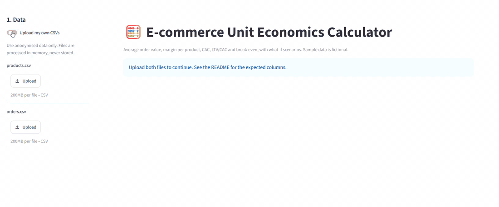
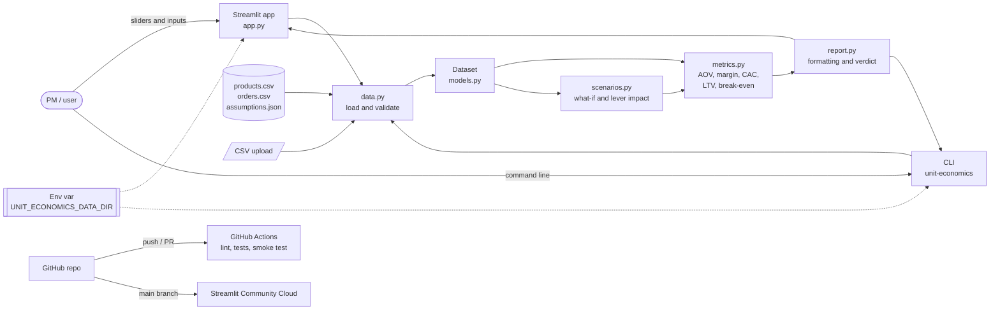

# 🧮 E-commerce Unit Economics Calculator

[](https://github.com/rafauto/ecommerce-unit-economics/actions/workflows/ci.yml)

[](LICENSE)

[](https://ecommerce-unit-economics.streamlit.app)

Turns an online store's orders and product catalog into the numbers behind every pricing,
shipping and marketing decision: average order value, margin per product, CAC, LTV/CAC and
break-even, with what-if scenarios.

**▶ Live demo:** https://ecommerce-unit-economics.streamlit.app (no sign-up, runs on fictional sample data)



## Why I built this

As a Product Owner, I keep seeing the same questions in e-commerce teams: *Can we afford free
shipping above R$99? Is paid social still worth it? Should we raise prices?* The answer
depends on unit economics, but the math usually lives in a spreadsheet nobody trusts.

I built this tool to show how I approach product decisions with financial rigour: define the
metric, make the assumptions explicit, and let the team test a decision before making it. All
data comes from **Lumi Custom**, a fictional online store of personalised mugs, bottles,
notebooks and pens.

## Features

- **Average order value (AOV)** and items per order from raw order lines.
- **Contribution margin per order**, counting product cost, payment fees, taxes, net shipping
  (with a free-shipping threshold) and packaging.
- **Margin per product**, sorted from the weakest SKU, with CSV download.
- **CAC by channel** and blended CAC, crediting each customer to their first-order channel.
- **Contribution LTV, LTV/CAC and CAC payback** in orders.
- **Break-even** orders and revenue per month, with a chart and a plain-language verdict.
- **What-if scenarios**: price, product cost, CAC, shipping cost and free-shipping threshold.
- **Lever impact**: which lever moves the monthly result the most for the same ±10% change.
- **Upload your own CSVs** (validated, processed in memory) or use the sample store.
- **CLI** (`unit-economics`) with the same report, for terminals and CI.

## Example output / Results

Real output for the fictional sample store (3,065 orders, July–September 2026), from
`unit-economics --data-dir examples/sample-store`:

| Metric | Value |
| --- | --- |
| Average order value | R$ 121.74 |
| Contribution per order | R$ 39.44 (32.4%) |
| Blended CAC | R$ 28.27 |
| LTV / CAC (3-month window) | 1.64 |
| Break-even orders / month | 1,052 (store is at 1,022 → 97%) |
| Monthly operating result | −R$ 1,201.04 |

**What the numbers say:**

- **The store is 30 orders a month short of break-even.**
- **Price is the strongest lever.** A 10% change moves the monthly result by about R$ 10.7k,
  almost twice as much as product cost and more than four times as much as CAC.
- **A +5% price** (`--price-change 5`) turns the month from −R$ 1,201 to **+R$ 4,097** and
  lowers break-even to 930 orders, assuming volume holds (see [Limitations](#limitations--privacy)).
- **Influencers cost R$ 61 per new customer**, against R$ 39 for paid social and R$ 34 for
  Google Ads.
- **Gift wrapping has the lowest margin, at 21%.** It leaves only R$ 1.97 per unit.

Lever impact on the monthly result:

| Lever | −10% | +10% |
| --- | ---: | ---: |
| Price | −R$ 10,545.64 | R$ 10,743.99 |
| Product cost | R$ 5,660.31 | −R$ 5,660.31 |
| CAC | R$ 2,450.00 | −R$ 2,450.00 |
| Shipping cost | R$ 1,941.17 | −R$ 1,941.17 |

These numbers are locked by regression tests (`tests/test_regression.py`).

## Tech stack

| Area | Tools |
| --- | --- |
| Language | Python 3.10+ |
| Calculations | pandas |
| Interface | Streamlit, argparse (CLI) |
| Quality | pytest, Streamlit AppTest, Ruff |
| CI | GitHub Actions (Python 3.10 and 3.12) |
| Deploy | Streamlit Community Cloud |
| Dev environment | Dev Container |

## Architecture / How it works



The user picks data and assumptions in the app or the CLI. `data.py` validates the files into
a `Dataset`, `scenarios.py` applies the what-if changes, and `metrics.py` computes the numbers.
Both interfaces share `report.py` for formatting. Nothing runs on external APIs, and no
secrets are needed.

**Key design decisions**

- **Pure calculation core.** All finance logic is in pure, fully tested functions. The UI and
  the CLI only format the results. See [ADR 0001](docs/decisions/0001-pure-calculation-core.md).
- **Explicit, standard metric definitions.** For example, CAC goes to the channel of the first
  order, and break-even is (fixed costs + marketing) / contribution per order. See
  [ADR 0002](docs/decisions/0002-metric-definitions.md).
- **Two plain CSVs as input.** Any store can export them, and they make the tool easy to audit
  against a spreadsheet.

## Project structure

```
ecommerce-unit-economics/
├── src/unit_economics/      # calculation package
│   ├── models.py            # CostAssumptions and Dataset
│   ├── data.py              # CSV/JSON loading and validation
│   ├── metrics.py           # AOV, contribution, product margin, CAC, LTV, break-even
│   ├── scenarios.py         # what-if scenarios and lever impact
│   ├── report.py            # formatting and plain-language verdict
│   └── cli.py               # unit-economics command
├── app.py                   # Streamlit interface
├── examples/
│   ├── generate_sample_data.py  # deterministic generator for the fictional store
│   └── sample-store/            # products.csv, orders.csv, assumptions.json
├── tests/                   # unit, integration, regression and app smoke tests
│   └── fixtures/tiny-store/ # 3 hand-checked orders
├── docs/
│   ├── product-brief.md     # problem, persona, hypothesis, MVP scope
│   ├── backlog.md           # user stories with acceptance criteria
│   ├── decisions/           # architecture decision records
│   └── screenshots/         # demo GIF and screenshots
├── .github/                 # CI, Dependabot, issue and PR templates
├── .devcontainer/           # reproducible dev environment
├── pyproject.toml           # package, dependencies, Ruff and pytest config
└── requirements.txt         # for Streamlit Community Cloud only
```

## Getting started

**Prerequisites:** Python 3.10 or newer and Git.

```bash
git clone https://github.com/rafauto/ecommerce-unit-economics.git
cd ecommerce-unit-economics
python -m venv .venv
source .venv/bin/activate        # Windows: .venv\Scripts\activate
pip install -e ".[dev]"
```

No API keys or secrets are needed. Optional settings are listed in `.env.example`.

Or open the repo in a **Dev Container** (VS Code or GitHub Codespaces): dependencies install
automatically.

## Usage

**Web app**

```bash
streamlit run app.py
```

Use the sidebar to switch to your own CSVs, adjust the cost assumptions and run a scenario.
Each KPI shows the difference from the baseline.

**Command line**

```bash
unit-economics                                   # sample store
unit-economics --price-change 5 --cac-change 10  # what-if scenario (percent)
unit-economics --free-shipping-threshold 249     # new threshold in BRL
unit-economics --data-dir path/to/my-store       # your own folder
```

**Input files**

| File | Columns |
| --- | --- |
| `products.csv` | `sku, name, category, price, unit_cost` (unit cost includes personalisation, e.g. printing or engraving) |
| `orders.csv` | `order_id, order_date (YYYY-MM-DD), customer_id, channel, sku, quantity` (one row per order line) |
| `assumptions.json` | rates as fractions (`0.039` = 3.9%), values in BRL; see `examples/sample-store/assumptions.json` |

## Running the tests

```bash
ruff check .
ruff format --check .
pytest
```

The tests run offline in a few seconds. They include hand-checked unit tests, data validation
tests, regression tests for the numbers in this README and a Streamlit `AppTest` smoke test.
CI also runs the CLI end to end on the sample store.

## Deployment

The demo runs on **Streamlit Community Cloud**, deployed from the `main` branch.

To publish your own copy:

1. Fork the repo.
2. On [share.streamlit.io](https://share.streamlit.io), create an app from your fork with main
   file `app.py`.
3. The platform installs `requirements.txt`. No secrets are needed.

## Project status and Roadmap

**Status:** MVP (`v0.1.0`). The main flow works end to end.

- [x] Unit economics engine with tests
- [x] Streamlit app with scenarios and lever impact
- [x] CLI and CI
- [ ] Returns and chargeback rate
- [ ] Demand elasticity for price scenarios
- [ ] Cohort-based LTV with retention curves
- [ ] Shipping zones and marketplace fees
- [ ] PDF export of the report

## Limitations / Privacy

- **Fictional data.** The sample store, products, customers and figures are invented and do
  not represent any real company.
- **No demand model.** Price scenarios keep order volume and basket mix constant.
- **No customer history before the period.** Every customer in the file counts as new in the
  period, and LTV only counts repeat orders inside it.
- **Rounding.** Money is calculated as floating point and rounded for display. Use it for
  decisions, not for accounting.
- **Uploads stay private.** Uploaded files are processed in memory and never stored. Use
  anonymised data, and never upload personal data.

## Contributing

Contributions are welcome. Please read [CONTRIBUTING.md](CONTRIBUTING.md) for setup, the pull
request flow and commit conventions.

## License

[MIT](LICENSE) © 2026 Rafaela Uto

## Author

**Rafaela Uto**: Product Owner working on digital products, data and generative AI.
[GitHub](https://github.com/rafauto)
